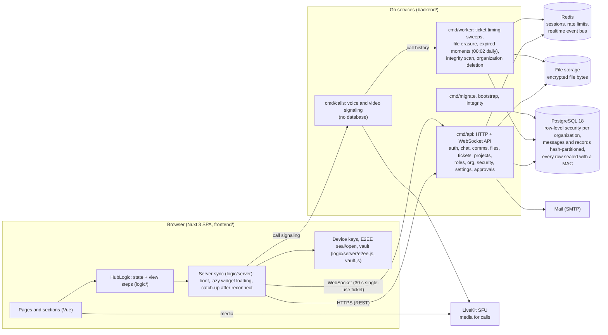

# Newgen Hub

An enterprise workspace: community wall, forums and private chats, calls and meetings, communications (memos, announcements,
newsletters, job posts), tickets, projects, calendar, files and secure share, approvals, roles and rights, organization structure,
and a security and audit centre. Messages, posts, notes and files are end-to-end encrypted: the server stores ciphertext.

- [frontend/](frontend/) — Nuxt 3 single-page app. `cd frontend && npm install && npm run dev`
- [backend/](backend/) — Go services (api, calls, worker). See [backend/README.md](backend/README.md)

## How it fits together

### What runs where

| Part | Job |
|---|---|
| `frontend/` | The app. Signs in, holds the device's encryption keys, decrypts everything locally, and loads each page's data only when that page is first opened. |
| `backend/cmd/api` | The only service that touches the database for users: REST and WebSocket, every module (auth, chat, comms, files, tickets, projects, roles, org, security, settings, approvals). Scales by running more copies behind a load balancer. |
| `backend/cmd/calls` | Call signaling and room control. Rooms are pinned to one instance by hashing the room id. |
| `backend/cmd/worker` | Background jobs, safe to run on several nodes: ticket timing, erasing deleted files, erasing moments after 24 hours, integrity scan, deleting organizations after their 30-day wait. |
| PostgreSQL | The system of record. Tenant isolation by row-level security; tamper detection by a MAC on every row and an append-only ledger. |
| Redis | Sessions, rate limits and the realtime event bus between API nodes. |

More detail: [backend/docs/ARCHITECTURE.md](backend/docs/ARCHITECTURE.md), [backend/docs/ENCRYPTED_PAYLOADS.md](backend/docs/ENCRYPTED_PAYLOADS.md),
[backend/docs/API.md](backend/docs/API.md).
